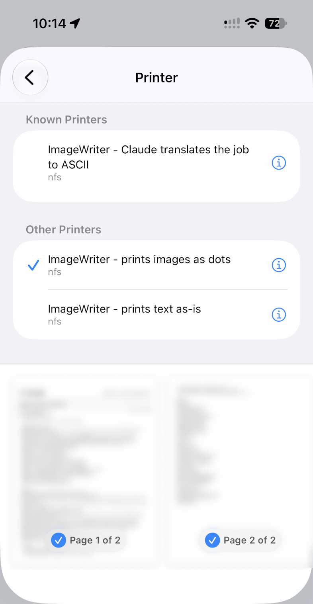

# imagewriter-pi

Print plain text, ASCII art and dot graphics on an Apple ImageWriter I from a Raspberry Pi, over a USB-to-serial adapter. The core tools need no driver or CUPS, just a small Python script.

```
Raspberry Pi -> USB-serial adapter -> serial cable -> ImageWriter
```

**Tested on one setup:** a 64-bit Raspberry Pi running Debian with kernel 6.18, a Prolific PL2303 adapter, and an ImageWriter I at 9600 baud. Other adapters and cables may behave differently, especially at the flow-control step below.

## You need

- Python 3, which Raspberry Pi OS already includes
- A USB-serial adapter that Linux supports
- A serial cable wired for a printer, not a straight-through modem cable. The ImageWriter I has a DB-25 port; most adapters are DB-9.

## Install

Get this folder onto the Pi, then:

```bash
./install.sh
```

This copies `iwprint`, `iwlines` and `iwsign` to `~/.local/bin`. It tells you if your PATH or `dialout` group membership needs changing; if you get added to `dialout`, log out and back in.

## Bring up a new Pi

**1. Check that the adapter appears.** You should see a `/dev/serial/by-id/` entry or `/dev/ttyUSB0`:

```bash
ls -l /dev/serial/by-id/ /dev/ttyUSB*
```

**2. Check the cable's busy line.** With the printer on, run this and press **Select** a few times:

```bash
iwlines --watch
```

`CTS` should go to 1 with the Select light on and 0 with it off. If `CTS` never changes, `iwprint` will wait forever under its default settings, so use `--no-flow` in the next steps. On the tested cable, `CTS`, `DSR` and `CD` all changed together.

**3. Print a test.** Load paper and make sure the Select light is on:

```bash
echo "Hello from the Pi" | iwprint
```

| What comes out | What to do |
|---|---|
| Garbled characters | Baud rate mismatch. Check the printer's DIP switches and pass `--baud` to match. |
| Lines print over each other | The printer needs a line feed setting changed in its DIP switches. |
| Double-spaced lines | The printer is adding its own line feed. Change its DIP switch. |
| Nothing | Check the Select light, then the cable. |

**4. Do a long test before trusting it.** Short prints can pass even when pacing is wrong. Run the full sample, about 4 pages and 3 minutes:

```bash
iwprint examples/ai_slop.txt
```

## Everyday use

```bash
iwprint notes.txt                        # print a file
iwsign "HAPPY" "HALLOWEEN!" | iwprint    # print a big sign
iwsign "HAPPY" > sign.txt                # save a sign without printing it
iwprint --graphics cat.pbm               # print a binary PBM image as dots
```

The printer fits 80 columns and 66 lines per page. Keep text plain ASCII.

| `iwprint` option | Purpose |
|---|---|
| `--port PATH` | Choose the device, or set `IWPRINT_PORT`. By default it auto-detects a single adapter. |
| `--baud N` | Match the printer's DIP switches. Default 9600. |
| `--cps N` | Pacing in characters per second. Default 100. Lower it if long jobs garble. |
| `--line-overhead S` | Extra seconds per line. Default 0.35. |
| `--no-flow` | Ignore the busy signal and rely on pacing alone. |
| `--graphics` | Input is binary PBM (P4) images, up to 576 dots wide at 72 dots per inch. |
| `--reset` | Return the printer to normal text settings first. |
| `--busy-timeout S` | Give up with exit status 5 if the printer stays busy for S seconds. |

## Why it paces every line

Sending a 4-page job at full speed with RTS/CTS flow control on garbled it about a page and a half in. Sending the same kind of text one line at a time at about the printer's own speed printed cleanly, so `iwprint` does that and still checks the busy signal before each line.

The likely cause is data already in flight in the USB adapter when the printer signals busy, but that was never measured directly. Treat it as a working theory.

## Print server

`printserver/` turns the Pi into a CUPS print server with four printers for the one ImageWriter:

| Printer | What it does |
|---|---|
| `ImageWriter-Text` | Prints what it's given. Plain text goes through unchanged, apart from wrapping at 80 columns and replacing anything the printer can't print. PDFs and PostScript have their text extracted. Images are rejected. |
| `ImageWriter-AI` | Sends the job to Claude, which rewrites it as a readable ASCII printout. Handles PDFs, images, web pages and text. |
| `ImageWriter-Graphics` | Prints images and PDFs as real dots, scaled to 8 inches wide. Line art stays pure black and white, and anything with shading is dithered. Runs on the Pi, with no API use. |
| `ImageWriter-Banner` | Claude designs a banner from your request and prints a proof sheet of three designs. A second job choosing one prints it sideways down the fanfold paper as one long strip. See [Banners](#banners). |

**Anything sent to `ImageWriter-AI` or `ImageWriter-Banner` is uploaded to the Anthropic API and billed to your API key.** Don't send it documents you wouldn't want to leave your network.

Install from a copy of this repo on the Pi. This installs CUPS and shares the printers on your local network, with remote administration off:

```bash
sudo sh printserver/install-printserver.sh
```

Then add your API key to `/etc/imagewriter/imagewriter.env`, which is readable only by root and the `lp` group:

```bash
sudo nano /etc/imagewriter/imagewriter.env
```

Print from the Pi:

```bash
lp -d ImageWriter-Text notes.txt
lp -d ImageWriter-AI article.pdf
```

#### Preview without using paper

`--preview` draws a job as it would come off the printer: dot-matrix text or dithered dots on tractor-feed paper, with the page count and an estimate of the printing time. Use `text`, `ai`, `graphics` or `banner` for one printer, or `all` to see the first three side by side. A job a printer would refuse shows blank paper and the reason.

```bash
/usr/lib/cups/backend/imagewriter --preview graphics photo.jpg photo-preview.png
/usr/lib/cups/backend/imagewriter --preview text notes.txt notes-preview.png
sudo /usr/lib/cups/backend/imagewriter --preview all cat.png cat-preview.png
```

Previews that include `ai`, `banner` or `all` need `sudo` to read the API key, and they call Claude and bill your key just like printing does. Claude draws the job afresh each time, so the printed version will differ. To print exactly what you previewed, save it as text and send that to `ImageWriter-Text`:

```bash
sudo /usr/lib/cups/backend/imagewriter --render ai article.pdf > article.txt
lp -d ImageWriter-Text article.txt
```

`--render graphics FILE > preview.pbm` writes the raw dots that `ImageWriter-Graphics` would send.

#### Banners

Send `ImageWriter-Banner` what you want, in any form Claude can read: a note, a screenshot, a PDF or plain text. For example: "HAPPY HALLOWEEN, bats and cobwebs along the border, about 4 feet". It prints a proof sheet with three small designs labelled A, B and C, each with its length and printing time, and a three-character code such as `K7M`.

To print one, send a second job saying which. `print K7M B` on its own is read on the Pi without calling Claude, when it arrives as text. Phones usually send a picture of the page instead, so Claude reads those. Anything else, such as "the second one" or "B with a thicker border", goes to Claude, which either prints that design or sends a new proof sheet.

```bash
echo 'HAPPY HALLOWEEN, bat border' | lp -d ImageWriter-Banner
echo 'print K7M B' | lp -d ImageWriter-Banner
```

The banner prints sideways with its start first and the top of the letters along the right edge, straight across the perforations. Leave it in one piece when you tear it off. Banners are 8 inches tall and up to `IMAGEWRITER_MAX_BANNER_FEET` long (default 10). They take roughly 20 to 25 seconds per inch, so a 4-foot banner takes about 20 minutes, more with large solid areas.

Claude draws each design as an SVG, which the Pi turns into dots with `rsvg-convert`. Before designing, Claude measures its lettering with that same renderer, because text widths vary a lot between fonts. Each design is then checked on the Pi. One that is drawn past the banner's edges is sent back to Claude once to fix, and dropped if it still doesn't fit. A design that refers to anything outside itself, such as another file or a web address, is dropped. Proof sheets are kept in `/var/lib/imagewriter/banners` for 7 days. A banner preview run with `sudo` saves its proof sheet the same way, so you can print a design you previewed by sending its code from your phone.

Other computers can add the printers from `http://PI-ADDRESS:631/printers/ImageWriter-Text`, `http://PI-ADDRESS:631/printers/ImageWriter-AI` and `http://PI-ADDRESS:631/printers/ImageWriter-Graphics`. The client must send PDF, PostScript, an image or plain text. Other formats are rejected rather than printed as junk.

### Phones

All the printers are announced on the local network with Avahi, so iPhones and Android phones on the same network can look for them in their normal print menu. Discovery usually doesn't cross VLANs or guest Wi-Fi. On Android, you may need to turn on the Default Print Service under your printing settings.



Raster jobs (URF or PWG) from a phone are converted to PDF before they reach the backend. They contain only images, so `ImageWriter-Text` refuses them and suggests `ImageWriter-AI`. The same goes for photos. `ImageWriter-Graphics` prints them directly.

**Once announced, `ImageWriter-AI` and `ImageWriter-Banner` appear in the print menu of everyone on your network, and their jobs are billed to your API key.** To stop announcing a printer while still using it from this Pi, run `sudo lpadmin -p ImageWriter-AI -o printer-is-shared=false`, and the same for `ImageWriter-Banner`.

**Limits:** each job stops at `IMAGEWRITER_MAX_PAGES` (default 4), and `ImageWriter-AI` rejects PDFs over `IMAGEWRITER_MAX_INPUT_PAGES` (default 50). Banners stop at `IMAGEWRITER_MAX_BANNER_FEET` (default 10) instead. `ImageWriter-Graphics` and `ImageWriter-Banner` drop a job if the printer stays busy for `IMAGEWRITER_BUSY_TIMEOUT` seconds (default 600). A failed job is dropped without retrying, and the reason appears in the CUPS job log. Change these in the same settings file.

Dark photos use a lot of ribbon, and a cancelled or dropped graphics job may leave part of a picture on the paper.

## Extras

`extras/photo2ascii.py` converts a photo to cartoon-style ASCII art. It needs Pillow and NumPy, and it's hit and miss: faces need a tight crop and usually a hand-traced outline to remove the background.

```bash
sudo apt install python3-pil python3-numpy
python3 extras/photo2ascii.py photo.jpg --crop 170,90,970,1150 --preview preview.png > photo.txt
```

Check the preview image before spending paper. See `--help` for the outline and tuning options.

## Tests

These need no printer:

```bash
python3 tests/test_tools.py
```

They don't cover the busy-signal path, which needs real hardware. Step 2 above checks that.

On a print server, this also tests the backend using a local stand-in for the Claude API, so it needs no key and spends nothing:

```bash
/opt/imagewriter/venv/bin/python tests/test_backend.py
```
